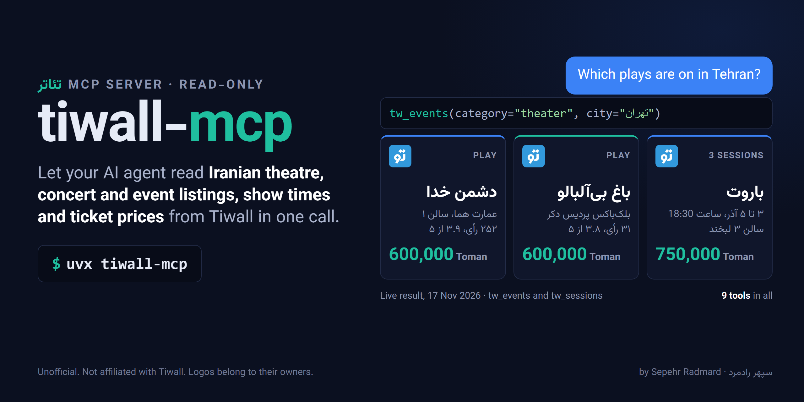

<!-- mcp-name: io.github.sepehr071/tiwall-mcp -->

<div align="center">



# tiwall-mcp: Tiwall (تیوال) Iranian theatre and event tickets MCP server for AI agents

**tiwall-mcp is an unofficial, read-only MCP server that lets an AI agent read events on Tiwall (تیوال, tiwall.com), the Iranian ticketing site for theatre, concerts, exhibitions, workshops and film screenings.**<br>
Its 9 tools list and filter events by category, city, venue and date, show one event with cast, venue, price and rating, its show times and sale status, venues, popular events and audience reviews.<br>
No API key or account is needed; it works in Claude, Cursor, Copilot and any other MCP client.

[](https://pypi.org/project/tiwall-mcp/)
[](https://pypi.org/project/tiwall-mcp/)
[](https://github.com/sepehr071/tiwall-mcp/actions/workflows/ci.yml)
[](https://github.com/sepehr071/tiwall-mcp/blob/main/LICENSE)

[For AI agents](#for-ai-agents) · [Quick start](#quick-start) · [Tools](#tools) · [Limits](#limits) · [فارسی](#فارسی)

</div>

---

## For AI agents

- **What:** unofficial MCP server (model context protocol) for tiwall.com: events by category, city, venue and day, one event in full, its show times, venues, popular events, audience reviews.
- **Install:** `uvx tiwall-mcp` or `claude mcp add tiwall -- uvx tiwall-mcp`. Transport: stdio. Needs [uv](https://docs.astral.sh/uv/getting-started/installation/) (Python 3.10+).
- **Auth:** none. Optional `TIWALL_MCP_PROXY` (HTTP proxy URL, or a comma-separated list); system proxy settings are ignored.
- **Access:** read-only; no confirmation needed. It cannot log in, reserve seats or pay. `tw_sessions` reads the public session list only, never the seat map.
- **Tools:** 9, all prefixed `tw_`. Typical flow: `tw_categories` -> `tw_events` (or `tw_search`) -> `tw_event(slug)` -> `tw_sessions(slug)` / `tw_reviews(slug)`; `tw_venues(name)` -> `tw_venue(slug)`.
- **Use when:** the user asks which plays or concerts are on, when and where, what tickets cost, what people say about a show, or what a venue is staging.
- **Do not use when:** the user wants to buy tickets or needs seats left.
- **Output:** compact JSON. Prices in Toman, ratings 0-5, ASCII digits; listing dates are Persian (Jalali) as on the site, session dates also Gregorian. Text is Persian.
- **Machine-readable:** [`server.json`](https://github.com/sepehr071/tiwall-mcp/blob/main/server.json).

## Quick start

You need [uv](https://docs.astral.sh/uv/getting-started/installation/). No API key or account.

Claude Code:

```bash
claude mcp add tiwall -- uvx tiwall-mcp
```

Claude Desktop, Cursor, VS Code and other clients:

```json
{
  "mcpServers": {
    "tiwall": { "command": "uvx", "args": ["tiwall-mcp"] }
  }
}
```

Example prompts:

- "Which plays are on in Tehran this weekend?"
- "Best-selling concerts right now."
- "Show times and price for Baroot."
- "What do people say about Crocodile?"
- <span dir="rtl">امشب در تهران چه نمایشی هست؟</span>
- <span dir="rtl">سانس‌ها و قیمت بلیت نمایش باروت چیست؟</span>

A real call on 17 Nov 2026: `tw_events(category="theater", city="تهران")` listed 154 events, among them «دشمن خدا» (3.9 from 252 votes, عمارت هما, 600,000 Toman) and «باغ بی‌آلبالو» (3.8 from 31 votes, 600,000 Toman); `tw_sessions("baroot")` returned three sessions, 3 to 5 Azar 1405 at 18:30, price 750,000 Toman.

## Tools

| Tool | What it does |
|---|---|
| `tw_categories` | Category codes, sort orders and main cities with ids |
| `tw_events` | Current events by category, city, venue, day or range, kids/comedy/online, order, paging |
| `tw_popular` | Best-selling, best-rated or newest events |
| `tw_search` | Search events by title, artist or venue words |
| `tw_event` | One event: venue, address, dates, time, duration, price, cast and crew, summary, tags, rating, sale status |
| `tw_sessions` | Show times of an event with seat wording and ticket price |
| `tw_venues` | Search venues and cities by name (ids, address, coordinates, rating) |
| `tw_venue` | A venue page (contacts, followers) and its current events |
| `tw_reviews` | Rating breakdown and audience posts of an event |

## Limits

- Tiwall is server-rendered HTML, so the tools parse pages; if the site changes its markup a tool can return empty fields until the parser is updated.
- The showcase has no paging: the whole list is fetched and sliced; past events are cut off.
- Seats left are not given as a number, only the site's wording ("مانده دارد") per session. The seat map is never opened.
- Unverified: sold-out wording on session pages, a venue with no events, and Persian-calendar `day=` input.
- No buying, reserving or login.

## فارسی

<div dir="rtl">

tiwall-mcp یک سرور MCP غیررسمی و فقط‌خواندنی برای تیوال (tiwall.com) است. عامل هوش مصنوعی با آن رویدادهای تئاتر، کنسرت، نمایشگاه و کارگاه را بر اساس دسته، شهر، سالن و روز فهرست می‌کند و برای هر رویداد عوامل، قیمت، امتیاز، سانس‌ها و دیدگاه تماشاگران را می‌خواند. بدون کلید API و حساب کاربری کار می‌کند. خرید بلیت و رزرو صندلی ندارد. نصب در Claude Code:

</div>

```bash
claude mcp add tiwall -- uvx tiwall-mcp
```

## Development

```bash
uv sync
uv run ruff check . && uv run ruff format --check .
uv run python -m pytest -q          # offline tests on trimmed real HTML
uv run python -m pytest -m live -q  # live calls to tiwall.com
```

Releases: bump the version in `pyproject.toml` and `server.json`, run `uv lock`, then push a `v*` tag; GitHub Actions publishes to PyPI.

## Disclaimer

Unofficial: not affiliated with, endorsed by or sponsored by Tiwall. Data and logos belong to their owners.

Author: Sepehr Radmard (سپهر رادمرد), [github.com/sepehr071](https://github.com/sepehr071) · [linkedin.com/in/sepehr-radmard](https://www.linkedin.com/in/sepehr-radmard)

## Related servers

More Iranian-site MCP servers (shops, travel, news, finance, jobs, maps): [github.com/sepehr071/iran-mcp](https://github.com/sepehr071/iran-mcp).

## مجوز استفاده (License)

<a href="https://www.linkedin.com/in/sepehr-radmard"></a>

**استفادهٔ شخصی و غیرتجاری رایگان است.** استفاده در شرکت، محصول پولی یا پروژهٔ مشتری به مجوز تجاری نیاز دارد؛ از راه [لینکدین](https://www.linkedin.com/in/sepehr-radmard) یا [گیت&zwnj;هاب](https://github.com/sepehr071) با سپهر رادمرد تماس بگیرید. متن کامل: [PolyForm Noncommercial 1.0.0](https://github.com/sepehr071/tiwall-mcp/blob/main/LICENSE). نسخه&zwnj;های پیش از 0.1.1 با مجوز MIT منتشر شده&zwnj;اند و همان مجوز را دارند.

Free for personal and non-commercial use under the [PolyForm Noncommercial License 1.0.0](https://github.com/sepehr071/tiwall-mcp/blob/main/LICENSE). Using it in a company, a paid product or a client project needs a commercial license: contact Sepehr Radmard on [LinkedIn](https://www.linkedin.com/in/sepehr-radmard) or [GitHub](https://github.com/sepehr071). Versions before 0.1.1 were released under MIT and stay under it.
